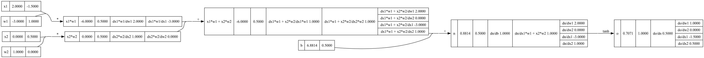

- [Intro](#intro)
- [Features](#features)
- [Usage](#usage)

## Intro
This is a Go implementation of https://github.com/karpathy/micrograd/tree/master - it was built while following Andrej Karpathy's first lecture https://github.com/karpathy/nn-zero-to-hero

## Features
- forward/backward propagate
- stochastic gradient descent
- generate graph (DOT) of calculated value (e.g. loss)
- train/predict on MNIST data 
  - shows it to be inefficient/non-optimsied

## Usage
Wrapped by a [simple cli](cmd/main.go), and triggered by a [Makefile](./Makefile)
- build a simple neural net and generate associated graph, the command argument `-propagationforward` generates the derivative of each node wrt the ancestral initial nodes
```
make neuralnet
```

- build a simple MLP that takes 3 inputs and has 1 output and has 5 hidden layers each with 10, 11, 12, 11, and 10 neurons respectively and generate associated graph
```
make mlp
```


- build and train a simple MLP and generate associated graph
```
make mlptrain
```


- build and train a simple MLP on the MNIST data (will be pulled from https://pjreddie.com/projects/mnist-in-csv/)
  - inspired by https://github.com/sausheong/gonn
```
make mnisttrain
```

- test a pre-trained MLP on the MNIST test data (will be pulled from https://pjreddie.com/projects/mnist-in-csv/)
```
make mnisttest
```
